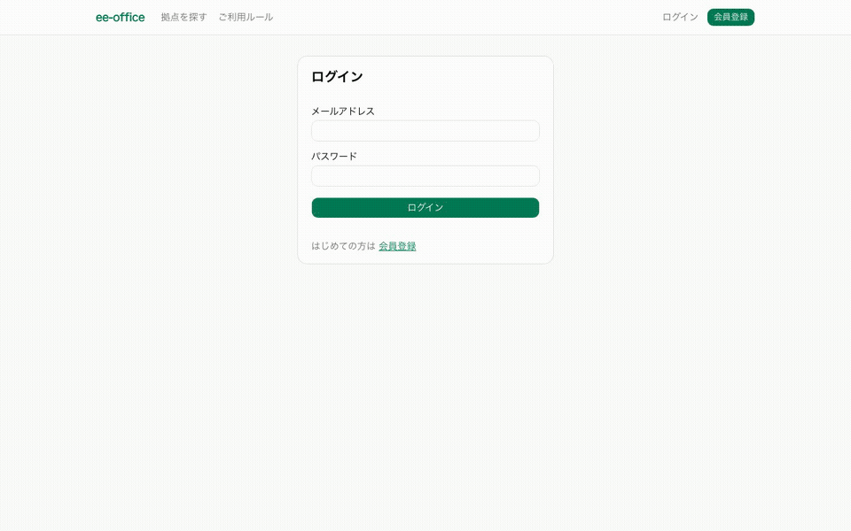
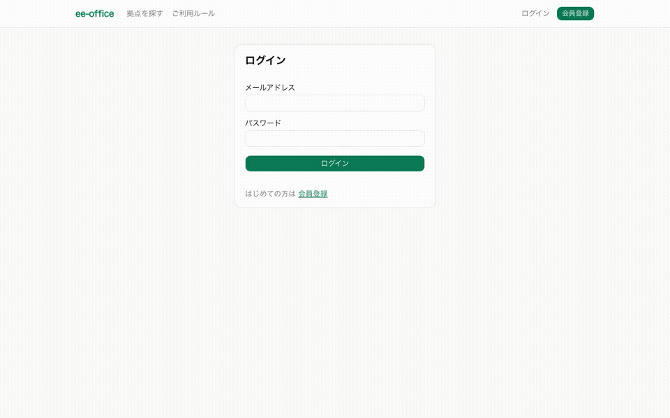

# AI 機能のデモ

手元の開発環境（seed のデータ）で、実際の Claude を呼んで録画したもの（2026-11-26）。
録り直すときは `cd frontend && npm run demo:record`（Rails の起動・`.env.local` の API キー・ffmpeg が必要。3本で約10円）。

## 1. 話して予約できるアシスタント（会員）

条件を文で書くと、AI が空きを調べて候補を出す。候補はコードが API の値で確かめてから出し、予約を確定するのは会員（録画では確認ダイアログで「戻る」を押している）。

## 2. 売上・利用状況の分析アシスタント（運営者）

AI は集計の API だけを使って答える。答えの数字は、集計の結果と照らし合わせて「✓ 集計の結果と一致」を付ける。

## 3. ご利用ルールの FAQ ボット（会員）

AI がご利用ルールを検索し、答えの文に根拠の番号を付ける。番号を押すと、ルールのその項目へ移動する。

